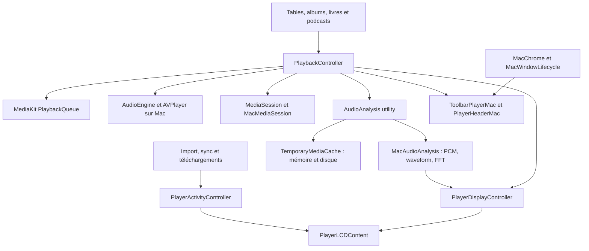

# Lecteur et session média

État du 20 novembre 2026, après les [[Corrections de revue du lecteur]]. Le lecteur vit dans le contenu de la fenêtre macOS, dans une rangée de 44 pt. Le noyau de lecture et les modèles restent partagés ; les contrôles AppKit, la session système et l’analyse AVFoundation sont propres au Mac. Le portage de cette interface vers Windows et Linux reste distinct, comme prévu par la spec PLR.

Le comportement visuel courant est décrit dans [[LCD du lecteur]]. La spec initiale reste dans [feature-toolbar-player.md](../_Specs/feature-toolbar-player.md). Les choix demandés ensuite par le propriétaire, notamment AirPlay à gauche du LCD et les chevrons sur la pochette, remplacent les dispositions initiales. Les constats de revue sont dans [[Revue du lecteur novembre 2026]].

## Responsabilités et circulation des données

`PlaybackController` possède la piste, la file figée au lancement, le volume de session, la vitesse et les transitions du moteur. Chaque chargement incrémente une génération et annule l’analyse précédente ; les résultats tardifs sont filtrés. La position exacte privilégie le moteur et tient compte d’un seek en attente. Les vues de bibliothèque n’observent pas les changements de temps du lecteur.

`PlayerDisplayController` publie ses changements par subscriptions annulables et possède le mode choisi, son repli si les paroles manquent, les chapitres, les paroles horodatées et le spectre. Il mémorise aussi la provenance des pistes pour revenir à la bonne section. `PlayerActivityController` reçoit les opérations existantes ; il ne scanne ni le disque ni les téléchargements de lui-même.

`ToolbarPlayerMac` possède les contrôles natifs. `MacChrome` dispose le header, la recherche et les véritables boutons de fenêtre. `MacWindowLifecycle` masque la fenêtre à sa fermeture, la réouvre depuis le Dock et attend les sauvegardes/nettoyages à la sortie de l’application.

## Correspondance avec PLR

| Point | Implémentation actuelle | Sources principales |
|---|---|---|
| PLR1 | Header permanent dans le contenu ; retrait du lecteur flottant et absence de `NSToolbar` | `WindowChromeMac`, `PlayerHeaderMac`, `MacWindowLifecycle` |
| PLR2 | Back/Play/Next, sélection de la vue, espace, maintien avec sauts de 5 s | `ToolbarPlayerMac`, `PlaybackController` |
| PLR3 | Volume natif personnalisé, sourdine mémorisée et sélecteur AVKit | `PlayerVolumeSlider`, `ToolbarRoutePickerMac` |
| PLR4 | Verre natif creusé, idle sans nom d’application, lecture/erreur/activité | `PlayerLCD`, `PlayerLCDContentMac` |
| PLR5 | Titre/artiste/album/pochette, retour à la provenance | `PlayerLCDContentMac`, `PlayerDisplayController`, `App` |
| PLR6 | Proposition de scrub, seek au relâchement, chapitres et touches fléchées | `PlayerScrub`, `LCDPlaybackPlot`, `LCDProgressOverlayMac` |
| PLR7 | Spectre stéréo pré-calculé, interpolation, pics et extinction finie en pause | `PlayerSpectrum`, `LCDPlaybackPlot`, `LCDSpectrumDisplayLink` |
| PLR8 | Waveform bornée et scrub sur sa zone | `AudioAnalysis`, `LCDPlaybackPlot` |
| PLR9 | LRC local, ligne suivante, repli vers Titre et échéance de changement de ligne | `SynchronizedLyrics`, `PlaybackDetailsMac`, `PlayerDisplayController` |
| PLR10 | Chevrons haut/bas au survol de la pochette et menu des modes | `PlayerLCDContentMac` |
| PLR11 | Activités d’import/sync/téléchargement, annulation et acquittement des erreurs | `PlayerActivityList`, `PlayerActivityController`, producteurs d’opérations |
| PLR12 | Popover virtualisé, insertion, suppression, ordre, aléatoire et répétition | `PlaybackQueue`, `PlayerQueueMac`, menus des listes |
| PLR13 | État et commandes de session portables | `MediaSession`, `PlaybackController` |
| PLR14 | Now Playing, commandes distantes, artwork asynchrone | `MediaSessionMac` |
| PLR15 | Menu du Dock alimenté par l’état courant | `DockPlaybackMenu`, `MacWindowLifecycle` |
| PLR16 | Analyse PCM/FFT hors du fil principal, trames partielles puis résultat complet | `AudioAnalysis`, `MacAudioAnalysis`, `SpectrumAnalyzer` |
| PLR17 | Cache versionné, plafond, éviction, Scratch et nettoyages événementiels | `TemporaryMediaCache` |
| PLR18 | Préférences portables, taille/plafond/vidage/Finder | `TemporaryCacheController`, `SettingsView`, `PortablePreferences` |
| PLR19 | Menu de piste, favoris, informations et vitesse pour les contenus parlés | `PlayerLCDContentMac`, `PlaybackController` |

Cette correspondance indique où se trouve l’implémentation ; elle ne remplace pas les constats de conformité et de robustesse de la revue.

## File et session

La file conserve un ordre indépendant du filtre ou du tri ultérieur de la bibliothèque. Les insertions déplacent un identifiant déjà présent plutôt que de le dupliquer ; la piste courante est protégée. Désactiver l’aléatoire restitue l’ordre de référence avec les nouvelles insertions après la piste courante. Le popover affiche la piste courante et les suivantes, sans historique visible, et demande les miniatures dans les cellules affichées.

La répétition de piste s’applique à la fin automatique, pas au bouton Next. Précédent remet à zéro après trois secondes ; sinon il passe à la piste précédente. Sur Mac, Next à la fin sans répétition ferme la session de lecture et revient à l’idle, conformément à PLR2.

La session système est publiée lors des changements de piste, d’état, de vitesse, de durée disponible ou de seek. Elle n’est pas republiée à chaque tick de progression. macOS extrapole la position depuis la position et la vitesse publiées. Les contenus parlés utilisent des commandes de saut de −15/+30 s et les vitesses 0,75/1/1,25/1,5/2× ; les musiques restent à 1×. Le volume n’est pas synchronisé avec celui du système.

## Analyse et caches

Une tâche utility décode en blocs, sans conserver le PCM complet. Sur Mac, elle produit la waveform et une FFT stéréo de 2 048 échantillons à 44,1 kHz. Seize bandes par canal sont stockées à 20 trames/s, un octet par bande. Les premières trames deviennent publiables après 200 ms d’audio décodé ; les publications suivantes sont espacées d’au moins 500 ms. Le spectre n’est pas calculé pour un fichier de plus de deux heures.

La waveform est limitée à 1 024 valeurs. Les formats disque utilisent `IPWF0001` et `IPSP0001`. Leur clé incorpore le chemin standardisé, la taille et la date de modification, hachés ; elle n’est pas une empreinte du contenu audio. Le cache mémoire `AudioAnalysis` a un coût cible de 12 Mio. Le cache disque est commun aux catégories Spectrum et Waveforms, avec un plafond initial de 200 Mio et une éviction par date d’utilisation. Les fichiers Scratch n’entrent pas dans ce plafond.

Les réglages de plafond, conservation et nettoyage sont portables. Les fichiers dérivés restent sur l’hôte. Vider le cache disque conserve les données déjà utilisées en mémoire et une écriture en cours peut faire réapparaître un fichier. Le verrou du cache protège une instance ; les fichiers de travail sont isolés dans des sous-dossiers de session et seuls ceux d’un processus confirmé arrêté sont nettoyés. Les détails sont dans [[Corrections de revue du lecteur]].

## Horloges et réactivité

| Travail | Cadence et condition d’existence |
|---|---|
| Progression AVPlayer | 250 ms, moteur actif et visibilité déclarée vraie |
| Spectre visible | CVDisplayLink plafonné à 30 Hz, 10 Hz avec Réduire les animations ; au plus une mise à jour UI en attente |
| Extinction du spectre | Niveaux pendant 450 ms, pics maintenus 120 ms de plus puis fondus en 160 ms ; arrêt ensuite |
| Paroles | Une échéance pour la prochaine ligne ; annulée si pause, masquage ou autre mode |
| Avance/recul maintenu | Départ après 400 ms puis 250 ms, pendant le suivi de l’appui |
| Activités | Révélation après 1 s ; fin réussie pendant 3 s ; erreur jusqu’à acquittement |
| Survol des boutons | Une échéance de 400 ms, annulée au départ du pointeur |
| Géométrie et caches | Événements et tâches ponctuelles ; aucun polling autonome |

Ces gardes sont les mécanismes présents dans le code. Elles ne prouvent pas à elles seules une consommation nulle de l’application entière. Le LCD est désormais l’unique propriétaire de la visibilité transmise au moteur ; le contrôle d’intégration vérifie les horloges arrêtées en pause et avec une fenêtre auxiliaire visible.

## Évolution des choix visuels

| Commit | Résultat principal |
|---|---|
| `2814bd2` | Implémentation PLR1–19, modèles et intégrations natives |
| `877f4ce` | Header dans le contenu pendant le plein écran |
| `e8b1627` | Offsets système et suppression de la bande auxiliaire visible |
| `360f1f1` | Boutons système hébergés dans le header et retrait animé |
| `96d3d08` | Course du volume, opacité et survol du bouton |
| `224960e` | Relief du transport, pochette/timeline bord à bord, extinction des pics |
| `5874699` | Espacements, AirPlay externe, chevrons, recherche et contrôles révélés |
| `4d93b08` | Slider élargi et largeur calculée selon le budget disponible |

## Vérification reproductible

`swift build --product iPodProMaxApp` compile le lecteur Mac. `swift test` couvre les modèles portables, notamment la file, les paroles, le scrub, le spectre, les caches et les préférences. Les contrôles natifs sont opt-in et ne doivent pas être lancés dans la bibliothèque réelle.

| Variable | Contrôle |
|---|---|
| `IPPM_CHECK_PLAYER=1` | Moteur simulé, transport, volume, file, activités et interactions natives |
| `IPPM_CHECK_AUDIO=<WAV>` | Moteur réel, durée, pause, seek, fin, erreur et publications média |
| `IPPM_CHECK_INTERACTIONS=1` | Contrôles natifs globaux de l’application |
| `IPPM_PLAYER_PREVIEW=title\|waveform\|lyrics\|spectrum\|activity` | Prévisualisation isolée avec `IPPM_PLAYER_FIXTURE=<WAV>` |
| `IPPM_PLAYER_PREVIEW=qa-final` et `IPPM_PLAYER_QA=1` | Intégration session/Dock/cache/recherche/fenêtre/plein écran |
| `IPPM_QA_APPEARANCE=dark\|light` | Apparence du contrôle d’intégration ; cohérente avec l’argument de lancement `-AppleInterfaceStyle` |
| `IPPM_LOG=<fichier>` | Journal du contrôle |

La vérification du hover exige que la fenêtre de sonde conserve le focus ; le harnais signale explicitement une indisponibilité avec code de sortie 2 si cette condition n’est plus vraie. Les mesures historiques d’analyse, de CPU et de disposition, avec leurs limites, restent dans [[LCD du lecteur]]. Les gestes AirPods et touches média physiques ne sont pas validés, faute de matériel disponible. Les builds Windows/Linux n’ont pas été exécutés dans cette revue.
